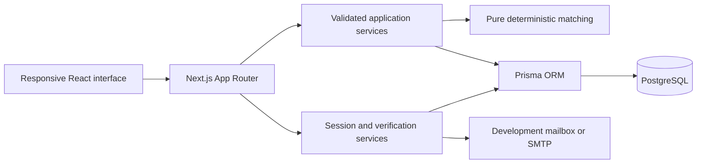
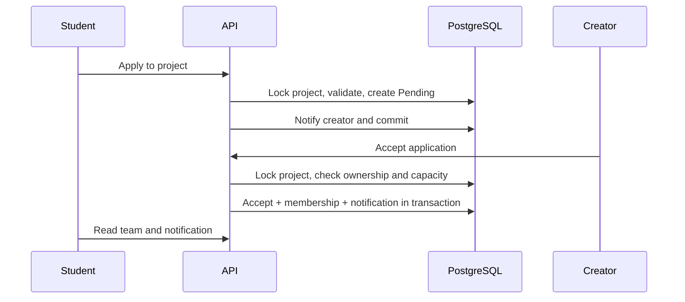

# Architecture

PeerConnect addresses the difficulty of finding teammates beyond existing personal contacts. It makes skills searchable, explains matches, and connects discovery to applications, teams and communication.

The system is a modular monolith. Next.js App Router serves React pages and route handlers. The shared application shell loads only authenticated API data. Public pages contain explicitly illustrative previews; private pages use PostgreSQL records.

## Boundaries

- components/workspace.tsx: navigation, forms, screen interactions and loading/empty/error states.
- lib/validation.ts: server input schemas; native accessible forms supply immediate required-field feedback.
- lib/matching.ts: pure score and ranking logic, independent of database and interface.
- lib/service.ts: queries, ownership/role rules and transactions.
- lib/auth.ts: opaque sessions and authentication lookup.
- app/api: HTTP boundary, origin checking, error mapping and authorization.
- prisma: normalized schema, committed migrations, fictional fixtures.

## Security decisions

Passwords use bcrypt with cost 12. Session secrets are random 256-bit values; only SHA-256 digests are stored. Cookies are HttpOnly and SameSite=Lax with seven-day expiry. Set SESSION_SECURE=true under HTTPS. Private API reads are no-store and require verified, enabled accounts. Mutations check Origin when provided. Prisma parameterizes values, including the tagged row-lock query. React escapes text. Profile discovery excludes emails and password hashes. Administration alone exposes account emails. Messages require conversation participation for both reads and writes. Session lookup checks current role/account state on every request.

Auth throttling is process-local, suitable for the single-process demo; production requires a shared rate limiter and operational review. HTTP request size checks supplement field-length validation; use a reverse-proxy body limit in a real deployment. SMTP is configurable; development verification is intentionally local-only.

## Concurrency

The Windows build runner retries transient directory-creation errors only inside its output directory. One prerender worker keeps the classroom build modest in memory use. This does not alter runtime authorization or application filesystem permissions.

Apply and accept lock the project row. The creator alone reviews applications. Accepted status, member insertion and notification commit together. The unique project/applicant and team/member constraints defend duplicate operations. Capacity reduction validates existing membership. No match operation writes recommendation records.

## Revised workflow

