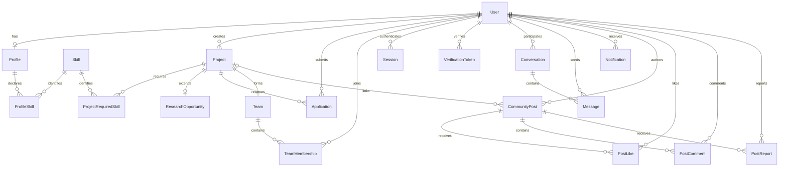

# Database design and revised ER diagram

PostgreSQL stores all private application state. Prisma declares foreign keys, indexes and unique constraints; SQL migrations are committed in prisma/migrations. The optional local database helper uses genuine PostgreSQL binaries, not an in-memory substitute. A normal PostgreSQL server can be used by changing DATABASE_URL.

## Important constraints

User.email and Skill.name are unique. Skills are separate rows with many-to-many join tables. A user has one optional profile. Application(projectId, applicantId), TeamMembership(teamId,userId), PostLike(postId,userId), PostReport(postId,reporterId) and Conversation(aId,bId) are unique. Conversation participant IDs are sorted by the service to obtain one pair per two users.

ResearchOpportunity.projectId and Team.projectId are unique. Creators are stored on Project, so the creator is not duplicated in TeamMembership. Capacity is team members plus one. Sessions and verification tokens contain hashes of random bearer secrets, with expiry timestamps.

Deleting a post cascades its comments, likes and reports. Deleting a project cascades its skills, research extension, applications and team, and clears post links. Skill deletion is restricted while referenced. Account deletion is restricted while the account owns projects; routine administration disables accounts instead. Other account-owned records cascade on deliberate account deletion.

Indexes cover creator/status and creation ordering, applicant/status, notifications by recipient/read/time, messages by conversation/time, feed visibility/time and comments by post/time. Search uses case-insensitive PostgreSQL contains queries, sufficient for a classroom dataset. Production-scale search would warrant full-text indexes and cursor pagination.

Text/list fields retain technologies and interests without making them change the matching formula. Foreign keys reject orphan applications and memberships. Team capacity and canonical conversation ordering are service invariants; they are not SQL CHECK constraints and must be preserved by any future write path.
